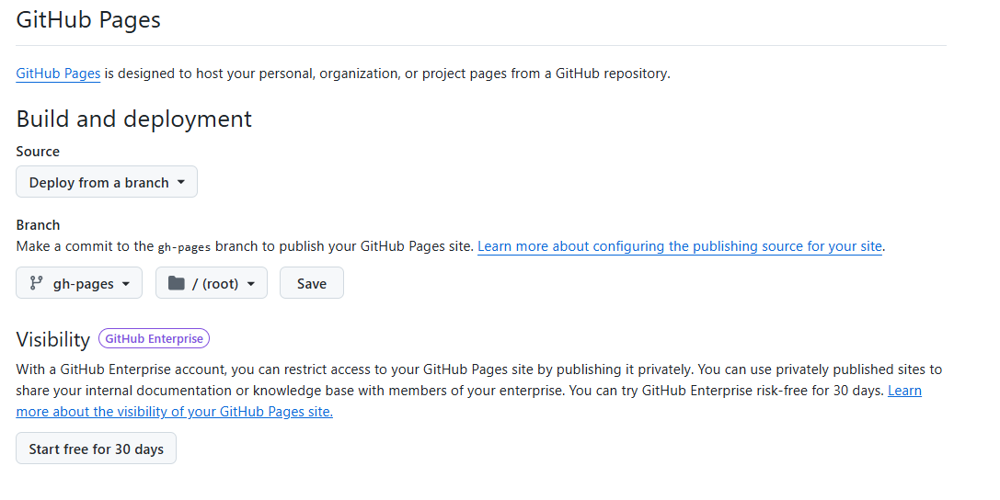
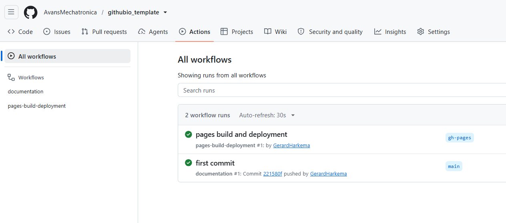

# Gebruik van de Githubio template

## Structuur van de template

De template is opgebouwd uit de volgende onderdelen:

- **Overzichtspagina**: Bevat een korte introductie en uitleg over de template.
- **Index**: De hoofdpagina van de documentatie met een overzicht van alle secties.
- **Licentiepagina**: Geeft informatie over de licentie waaronder de template wordt verspreid.

Je kunt deze onderdelen uitbreiden met extra secties en pagina's afhankelijk van de behoeften van je project.

:::{note}
Je kunt de bestanden (met uitzondering van de `.git`-map) toevoegen aan je eigen project. Doe dat in de hoofdmap van je project. Nadat je dit gedaan hebt, zal automatisch de documentatie worden gegenereerd op de Githubio-pagina van je project.
:::

## Gebruik van de template

Om de template te gebruiken, volg je de onderstaande stappen:

1. **Kloon de template**: Maak een kopie van de template naar je eigen GitHub-repository.

```bash
git clone https://github.com/githubio_template/repository.git
```

2. **Geef de repository een nieuwe naam**: Hernoem de lokale map naar de gewenste naam voor je project.

3. **Verwijder .git**: Verwijder de bestaande Git-configuratie om een schone start te maken met je eigen repository.

::::{tab-set}

:::{tab-item} Linux / macOS
```bash
rm -rf .git
```
:::

:::{tab-item} Windows (PowerShell)
```powershell
Remove-Item -Recurse -Force .git
```
:::

:::{tab-item} Windows (cmd)
```bat
rmdir /s /q .git
```
:::

::::

4. **Maak een nieuwe GitHub-repository aan**: Ga naar GitHub en volg de instructies om een nieuwe repository aan te maken.

5. **Pas de inhoud aan**: Bewerk de overzichtspagina, index en licentiepagina om deze aan te passen aan je project.

6. **Voeg extra secties toe**: Indien nodig kun je extra pagina's en secties toevoegen om je documentatie uit te breiden.

7. **Publiceer op GitHub Pages**: Zorg ervoor dat je repository is ingesteld om GitHub Pages te gebruiken, zodat je documentatie online beschikbaar is (zie hieronder). Gebruik hiervoor het `git push`-commando om je wijzigingen naar de remote repository te sturen.

```bash
git add .
git commit -m "<JOU COMMENTAAR HIER>"
git push
```

## Githubio publicatie

Om je documentatie op GitHub Pages te publiceren, volg je deze stappen:

1. Ga naar de instellingen van je GitHub-repository.
2. Scroll naar beneden naar het gedeelte "Pages".

3. Selecteer de bron voor je GitHub Pages-site (meestal de `main`-branch en de map `gh-pages`).
4. Klik op "Opslaan" om de instellingen te bevestigen.

Na het voltooien van deze stappen wordt je documentatie gepubliceerd en is deze online beschikbaar via de opgegeven URL.

## Valkuilen

Bij het gebruik van deze template zijn er enkele valkuilen waar je op moet letten:

- Zorg ervoor dat je de `.git`-map verwijdert voordat je een nieuwe repository aanmaakt, anders kunnen er conflicten ontstaan.
- Controleer altijd of de bron voor GitHub Pages correct is ingesteld, anders wordt je documentatie mogelijk niet gepubliceerd.
- Pas de inhoud van de overzichtspagina, index en licentiepagina aan om te voorkomen dat er verouderde informatie wordt weergegeven.
- Houd rekening met de structuur van je project, zodat de documentatie correct wordt gegenereerd.
- Monitor de status van je `git push` in het action logboek om te controleren of de documentatie correct wordt gepubliceerd.



